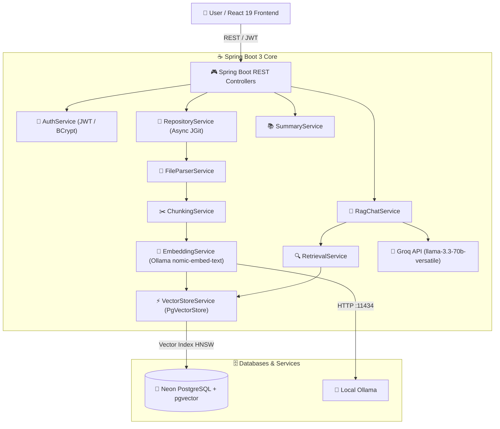

# 🤖 Repository Intelligence AI Agent

An enterprise-grade, context-grounded **Retrieval-Augmented Generation (RAG)** AI Agent built with **Java 21, Spring Boot 3, Spring AI, Neon PostgreSQL (pgvector), Ollama, and React 19**.

Paste any public GitHub repository URL, and the AI Agent will clone, parse, chunk, embed, and index the entire codebase into a vector store—allowing you to ask complex technical questions, perform semantic similarity searches, and view source code line attributions without LLM hallucinations.

---

## 🌟 Key Features

- **⚡ Automated Ingestion & Pipeline**: Depth=1 JGit repository cloning, noise folder filtering (`node_modules`, `target`, `.git`), and non-blocking asynchronous pipeline status updates (`PENDING` → `CLONING` → `PARSING` → `EMBEDDING` → `INDEXED`).
- **🧩 Structural Code Boundary Chunking**: Language-specific regex parsers for Java, JavaScript, TypeScript, Python, and C++ methods/classes with a sliding window fallback and a hard 2,000-character cap to prevent token overflow.
- **🧬 Local Vector Embeddings**: 768-dimensional dense vector embeddings generated via local Ollama (`nomic-embed-text`) stored in Neon PostgreSQL using `pgvector` HNSW indexes.
- **🛡️ 100% Repository-Scoped Anti-Hallucination RAG**: Dual-level isolation (database filter expressions + prompt-level active repo binding) ensuring questions about Repository A never leak answers from Repository B.
- **📚 Architecture & README Generator**: Generates comprehensive, 5-section Markdown architecture overviews cached directly in PostgreSQL.
- **🔐 JWT Authentication & Security**: Stateless Spring Security authentication with BCrypt password hashing, JWT token signing (HS256), and user-scoped data access.
- **🎨 Glassmorphic React 19 Frontend**: Dark mode workspace with real-time status polling, interactive source code attribution drawers, line range badges (`Lines 10-45`), copy code snippets, and semantic search tester drawer.

---

## 🏗️ System Architecture



---

## 🛠️ Technology Stack

### Backend
- **Language**: Java 21 (JDK 21)
- **Framework**: Spring Boot 3.5.4
- **AI Orchestration**: Spring AI 1.0.1 (`spring-ai-starter-vector-store-pgvector`, `spring-ai-starter-model-openai`)
- **Security**: Spring Security + JJWT 0.12.6
- **Database**: Neon PostgreSQL with `pgvector` extension
- **Embedding Model**: Ollama `nomic-embed-text` (768 dimensions)
- **LLM Provider**: Groq API via Spring AI OpenAI-compatible endpoint (`llama-3.3-70b-versatile`)
- **Git Operations**: Eclipse JGit 7.7.0

### Frontend
- **Framework**: React 19, TypeScript, Vite
- **Styling**: Tailwind CSS v4, Glassmorphism Design Tokens
- **Icons**: Lucide React
- **HTTP Client**: Axios with request/response Bearer token interceptors

---

## 🔌 API Endpoints

### Authentication (`/api/auth`)
| Method | Endpoint | Description |
|---|---|---|
| `POST` | `/api/auth/register` | Register a new user account |
| `POST` | `/api/auth/login` | Authenticate user and receive JWT token |
| `GET` | `/api/auth/me` | Fetch authenticated user profile |

### Repositories (`/api/repositories`) — Protected 🔒
| Method | Endpoint | Description |
|---|---|---|
| `POST` | `/api/repositories` | Register and initiate async cloning & indexing of a GitHub repo |
| `GET` | `/api/repositories` | List all indexed repositories |
| `GET` | `/api/repositories/{id}` | Get status and details of a repository |
| `GET` | `/api/repositories/{id}/search` | Direct semantic vector search (`query`, `topK`) |
| `GET` | `/api/repositories/{id}/summary` | Fetch or generate cached Architecture Overview |
| `DELETE` | `/api/repositories/{id}` | Delete repository and stored vector embeddings |

### RAG Chat (`/api/repositories/{id}/chat`) — Protected 🔒
| Method | Endpoint | Description |
|---|---|---|
| `POST` | `/api/repositories/{id}/chat` | Send a context-grounded question to the RAG Agent |
| `GET` | `/api/repositories/{id}/chat/sessions` | Fetch chat session history |

---

## 🚀 Quickstart & Local Setup

### Prerequisites
- JDK 21+
- Node.js 18+ & npm
- Local [Ollama](https://ollama.com) with model pulled: `ollama pull nomic-embed-text`
- Neon PostgreSQL database with `CREATE EXTENSION IF NOT EXISTS vector;`

### 1. Environment Variables Configuration
Set the following environment variables (or configure in `backend/src/main/resources/application.properties`):

```bash
export SPRING_DATASOURCE_URL="jdbc:postgresql://<neon-hostname>:5432/<dbname>?sslmode=require"
export SPRING_DATASOURCE_USERNAME="<username>"
export SPRING_DATASOURCE_PASSWORD="<password>"
export GROQ_API_KEY="gsk_..."
export JWT_SECRET="your32ByteSecretKeyForLocalDevOnly12345"
```

### 2. Start Backend Server
```bash
cd backend
mvn spring-boot:run
```
The backend starts on `http://localhost:8080/api`.

### 3. Start Frontend Development Server
```bash
cd frontend
npm install
npm run dev
```
Open **[http://localhost:5173/](http://localhost:5173/)** in your browser.

---

## 🧪 Running Automated Tests

```bash
cd backend
mvn test
```

Unit & Integration test coverage includes:
- Structural regex chunking and sliding window fallback (`ChunkingServiceTest`)
- RAG pipeline grounding and resource scoping (`RagChatServiceTest`)
- Controller validation & authentication rejection (`AuthControllerTest`)

---

## 📄 License
This project is created for demonstration and resume portfolio purposes.
